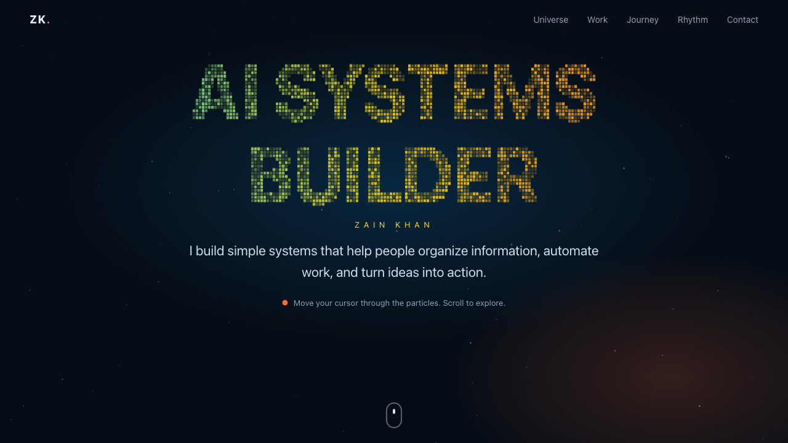

<p align="center">
  
</p>

# Zain Khan — Universe

> An immersive portfolio: a particle hero, a draggable 3D map of every project, a scroll-drawn timeline and the real commit rhythm.

[**Live demo →**](http://organize-with.me/zain-universe/) · [Issues](https://github.com/zainkhan1994/zain-universe/issues) · [Scope](SCOPE.md) · [Glossary](GLOSSARY.md)

[](http://organize-with.me/zain-universe/)    

## The Problem

A portfolio built from a list of links hides how the work connects, and screenshots alone don't show momentum. Recruiters and collaborators want to see range and trajectory in a minute.

## The Fix

This site turns the project history into one explorable space: particles assemble into 'AI Systems Builder', 32 projects float as stars in five clusters you can rotate and open, a timeline draws as you scroll, and a bar chart shows 497 real commits over 29 months. It is plain HTML, CSS and canvas, so it loads fast and has nothing to maintain.

### What it does

- Particle hero that assembles 'AI SYSTEMS BUILDER' and reacts to cursor and touch
- Draggable 3D project map: five clusters, hover tooltips, click for details, cluster filters, keyboard-accessible project list
- Domains: four areas of work with real logos (local brand files and Simple Icons SVGs), Google Skills badges and Space Apps Houston growth figures from the owner's notes
- Selected-work cards with real screenshots and 3D tilt
- Scroll-drawn timeline from first-commit dates
- Commit-rhythm chart from real git history (bots excluded)
- Respects prefers-reduced-motion; responsive down to phones

<details>
<summary><strong>Setup — macOS</strong></summary>

No build step. Prerequisites: git and a browser.

```bash
git clone https://github.com/zainkhan1994/zain-universe.git
cd zain-universe
python3 -m http.server 8000
```

Then open http://localhost:8000/.

</details>

<details>
<summary><strong>Setup — Linux</strong></summary>

No build step. Prerequisites: git and a browser.

```bash
git clone https://github.com/zainkhan1994/zain-universe.git
cd zain-universe
python3 -m http.server 8000
```

Then open http://localhost:8000/.

</details>

<details>
<summary><strong>Setup — Windows</strong></summary>

No build step. Prerequisites: git, Python 3 and a browser. Use PowerShell.

```powershell
git clone https://github.com/zainkhan1994/zain-universe.git
cd zain-universe
py -m http.server 8000
```

Then open http://localhost:8000/.

</details>

<details>
<summary><strong>Architecture</strong></summary>

`js/data.js` is the single source of content. `hero.js` samples the text 'AI SYSTEMS BUILDER' from an offscreen canvas and animates particles to those points with a spring. `universe.js` places each project deterministically around its cluster hub (seeded from the project id), projects points with a simple perspective transform, and handles drag, hover, click-to-focus and filters. `main.js` builds the cards, timeline and chart from the data and animates them when scrolled into view.


<a id="structure"></a>

| Path | Purpose |
|---|---|
| `index.html` | page structure and sections |
| `css/style.css` | design tokens, layout, animations |
| `js/data.js` | all content: clusters, projects, featured cards, timeline, stack, contact |
| `js/hero.js` | particle text hero |
| `js/universe.js` | 3D project map |
| `js/main.js` | reveals, counters, cards, timeline, chart |
| `data/rhythm.json` | monthly commit counts (generated from git history) |
| `assets/` | screenshots and favicon |

</details>

<details>
<summary><strong>Tech stack</strong></summary>

- HTML, CSS, vanilla JavaScript
- Canvas 2D with a hand-written 3D projection
- IntersectionObserver for reveals and counters
- GitHub Pages (no build step)

</details>

<details>
<summary><strong>Screenshots</strong></summary>


_Captured from the live deployment on 2026-10-11._

</details>

<details>
<summary><strong>Changelog</strong></summary>

- 2026-10-11 — feat: immersive portfolio site (particle hero, 3D project universe, timeline, commit rhythm)

Full history: [CHANGELOG.md](CHANGELOG.md).

</details>

## For agents and contributors

- [`AGENTS.md`](AGENTS.md) / [`CLAUDE.md`](CLAUDE.md) — commands, structure, conventions
- [`SCOPE.md`](SCOPE.md) — what this project will and won't do
- [`GLOSSARY.md`](GLOSSARY.md) — shared vocabulary
- Issues are tracked in [GitHub Issues](https://github.com/zainkhan1994/zain-universe/issues); docs live in [`docs/`](docs/).

## License

MIT — see [LICENSE](LICENSE).
